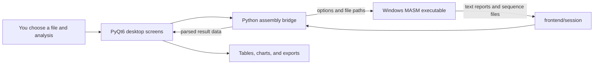

# DNA Analyzer

**A desktop app for exploring DNA sequences, built with Python, PyQt6, and x86 assembly.**

DNA Analyzer takes a text file containing a DNA sequence and turns it into something you can explore: letter counts, GC content, sequence conversions, pattern matches, comparisons, primer estimates, charts, and a PDF report. You can use the included examples without knowing biology or programming.

---

## The story behind the project

Imagine a recipe written with only four letters. A very long recipe. The letters are **A**, **T**, **C**, and **G**, and their order is what makes one DNA sequence different from another. A DNA sequence can be millions of letters long, so a computer is useful for counting, searching, and comparing it accurately.

Sometimes a scientist does not know which letter belongs at a certain position. The letter **N** is often used to mean “unknown here.” It is not a fifth DNA base. DNA Analyzer keeps those positions visible and treats them carefully in its calculations.

DNA Analyzer is a small desktop laboratory for this kind of sequence exploration. You choose a sequence file, pick an operation, and the app presents the result in readable screens, charts, and exportable files. Under the hood, a Python desktop interface asks a separate assembly-language engine to do the sequence calculations.

### A quick example

Imagine that you have a file containing 1,000 DNA letters. You might first ask, “Did I load the whole sequence?” The overview shows the length and counts. Next, you might ask, “Is one region richer in G and C than another?” GC windows break the sequence into sections and chart the result. If you have a second version of the sequence, similarity shows which positions differ. Finally, you can save the analyses you ran into a PDF.

That is the central idea of the project: take a long, hard-to-read string and make common questions about it easier to explore.

> This is an educational software project. It does not diagnose health conditions, design lab-ready experiments, or replace specialist tools and review.

## What is a FASTA file?

FASTA is a simple text format for sequence data. It starts with a title line beginning with `>` and then lists the sequence. For example:

```text
>My sample sequence
ATGCGTACGTAG
GCTAACGT
```

The first line is the title. The other lines are the DNA. They are treated as one continuous sequence, so the line breaks are just there to make the file easier to read. This app accepts DNA letters A, T, C, G, and N. It accepts sequence letters in either uppercase or lowercase.

## What can I do in the app?

After you load a FASTA file, choose a page in the app's navigation panel. Each page focuses on one question you might ask about the sequence.

### 1. Overview: what letters are in my sequence?

The overview counts every A, T, G, C, and N and shows the sequence length. It also calculates **GC content**: the percentage of known A/T/G/C letters that are either G or C. Unknown `N` letters are not included in the GC percentage because their true identity is not known.

This is a useful first look when opening a new file. It can tell you whether the file loaded as expected and give you a quick summary before you run the other tools.

### 2. GC windows: does GC content change along the sequence?

Instead of calculating GC content once for the whole sequence, this tool measures it in smaller sections called windows. You choose the number of bases in each window and the step between windows. For example, a window of 100 and a step of 25 measures bases 1–100, then 26–125, and so on.

The app displays the window values and a chart so you can see where GC content rises or falls. Windows containing unknown `N` letters calculate percentages from their known A/T/G/C bases. You can export the window table as a CSV file and open it in a spreadsheet program.

### 3. 2-bit compression: can this sequence be stored in less space?

The compression tool packs the four ordinary DNA bases into two bits per base. Since `N` is not one of those four bases, it stores a separate bit mask to remember where unknown positions were. The output also contains a small header with format and length information and a checksum.

After writing the compressed file, the engine checks that it can reconstruct the original sequence. The screen reports the size and whether the round-trip check succeeded. Compression is **not encryption**: it makes data smaller; it does not conceal the sequence.

### 4. Reverse complement: what is the matching opposite strand?

DNA strands pair in a predictable way: A pairs with T, and C pairs with G. To create the reverse complement, the app replaces each letter with its partner and reverses the order. This is a common way to represent the opposite DNA strand in its standard reading direction. The result can be exported as a FASTA file.

### 5. DNA to RNA: what does a simple RNA copy look like?

RNA is a related molecule that uses U where DNA uses T. This tool creates an RNA version of the loaded sequence by replacing T with U and reports how many U letters were created. You can copy the result or export it as a sequence file.

### 6. Codon translation: what amino acids do groups of three represent?

The translation page first converts T to U, then reads the sequence from the first position in groups of three. Each three-letter group is called a **codon**. The app looks up each codon in the project's table at `backend/data/codon_table.csv` and shows its amino-acid symbol and name, along with a summary of codon counts.

This project uses one reading frame: groups start at positions 1, 4, 7, and so on. It does not search for a start position or compare all possible reading frames. Any final one or two letters that cannot make a complete group are not a complete codon. Codon details and the RNA sequence are available in the result view.

### 7. Pattern search: where does a short sequence occur?

Enter a pattern such as `ATG` to find each place it appears in the loaded sequence. The search accepts A, T, G, C, and N and ignores whether you typed the letters in upper- or lowercase. The results include positions and a match count. Overlapping matches are included; a new match can begin before the previous match has finished.

### 8. Sequence similarity: how do two files compare at the same positions?

Choose a second FASTA file and the app compares it with the loaded one, letter by letter at matching positions. It reports matches, mismatches, and any extra unpaired letters if one sequence is longer.

This is a **positional comparison**, not a full biological alignment. It does not shift the sequences to compensate for insertions or deletions. The report is most useful when the sequences are already expected to correspond position by position.

### 9. Primer Tm: what are the simple temperature estimates for short candidates?

Choose a candidate length and the engine scans each possible window of that length. For windows containing only A, T, G, and C, it uses the basic Wallace rule: 2 degrees for each A or T and 4 degrees for each G or C. Windows containing `N` are excluded from valid candidates.

The result lists candidate positions, sequences, base counts, and estimated melting temperatures (Tm). This is an introductory estimate, not a complete primer-design model: it does not account for salt concentration, DNA concentration, or other laboratory conditions.

### PDF report: can I save the results together?

The PDF page creates a report for the currently loaded sequence. It includes the sequence overview and the analyses you have already run. If you have not run an analysis, the report marks that section as not run. Choose a destination and filename when the app asks where to save it.

## A suggested first session

If this is your first time using the app, try this path:

1. Open `backend/sample_data/valid_sample.fasta` from the landing screen.
2. Look at the overview. Check the sequence length and the A, T, G, C, and N counts.
3. Open **GC windows**, choose a window size and step, and run the analysis. The table gives exact values; the chart helps show the pattern at a glance.
4. Try **Reverse complement** or **DNA to RNA** to see how sequence letters are transformed.
5. Search for a short pattern such as `ATG`, then look at the reported positions.
6. Open **Codon translation** to see triplets and their table lookups.
7. If you have a second FASTA file, open **Sequence similarity** and compare the files.
8. Generate a PDF report after running the analyses you want to include.

You do not need to run every operation. Each page can be used on its own after a sequence is loaded, except similarity, which also needs a second FASTA file.

## What happens to my files?

The app reads the FASTA file you choose from its current location. Its analysis flow runs locally: Python starts the local assembly executable and exchanges files in the project's `frontend/session/` folder. The app does not need to upload a sequence to an online database or remote analysis service.

The session folder contains intermediate files and reports used to pass results from assembly back to Python. Those files may be rewritten when you run another operation. They are not the original input. When you use an export button, the app asks where to save the output. Choose a folder you can find again, such as Documents.

The `.gitignore` file excludes generated session data, compiled build files, and Python caches from future Git commits. It does not exclude the source code, the codon table, or the example FASTA inputs.

## How the project is built

The project combines a user-friendly desktop interface with a separate low-level analysis engine. The two parts have different jobs:

| Part | Technology | What it does |
|---|---|---|
| Desktop interface | Python 3 and PyQt6 | Creates the app window, navigation, controls, result tables, charts, and user messages. |
| Assembly bridge | Python standard library | Builds command-line requests, starts the engine, reads its report files, and turns the results into data the interface can display. |
| Analysis engine | 32-bit x86 MASM assembly | Reads FASTA input, validates and cleans the sequence, runs the calculations, and writes reports and output sequences. |
| Codon lookup | CSV data file | Maps RNA codons to amino-acid symbols and names for translation. |
| PDF export | Python and fpdf2 | Formats completed results into a PDF document. |
| Charts | Python and PyQt6 painting | Draws base composition and GC-window visualizations in the desktop app. |

### Why use both Python and assembly?

Python makes it practical to build and update a desktop interface: it connects buttons to actions, manages screens, and shapes results into tables and charts. Assembly gives this project a chance to implement sequence processing close to the machine level, where the program explicitly manages memory, bytes, loops, and file operations. The split also makes the boundary between the user interface and the calculation engine visible and educational.

The assembly engine is not a Python extension. It is a separate Windows program. The Python interface cannot perform the analyses by itself: it needs the matching executable at `backend/build/DNAAnalyzer.exe`.

### How the frontend connects to the assembly backend

The connection works like a small hand-off between two programs:

1. You choose an operation in the PyQt6 window. For example, you might choose GC windows and enter a window size and step.
2. The Python bridge in `frontend/bridge/asm_bridge.py` prepares the required input paths and command-line options.
3. The bridge starts `backend/build/DNAAnalyzer.exe` as a separate process. The engine runs in the local session folder, so its intermediate files and reports are kept with the app's local session data.
4. The assembly engine writes a plain-text report made of simple `NAME=value` lines. Some operations also write a sequence file or a detail file containing rows such as window values or pattern matches.
5. Python reads those files, converts values into dictionaries and lists, then sends the result to the relevant screen. This keeps the assembly engine independent of the graphical interface.

For example, when you request GC windows, Python sends the operation name, cleaned sequence path, window size, step size, and report path. The engine calculates the rows and writes lines such as `WINDOW_1=1,100,52,52.00,48.00`. The bridge parses that line into fields for the table and chart. The other operations use the same general pattern, with extra paths or settings where needed.



Long-running engine requests are run through a PyQt worker thread. A worker lets the window remain responsive while the engine processes a sequence. When the operation finishes, the worker signals the main window to display the result. PDF creation is handled by the Python PDF module after the app gathers the available results.

The exchange uses command-line arguments and files because this is a simple, inspectable interface between two separately built programs. The report files are plain text, so they can also be opened when diagnosing an issue. The compressed sequence is binary and is not intended to be read as ordinary text.

### How the assembly features are implemented

The assembly engine is divided into focused source files under `backend/src/`. Shared structures and operation definitions live in `backend/include/`.

- **FASTA loading and validation** (`fasta.asm`): opens the file, reads its header and sequence, removes formatting whitespace, normalizes bases to uppercase, and reports malformed or unsupported input.
- **Statistics** (`statistics.asm`): scans the cleaned sequence once to count each base, totals the canonical bases, and calculates base and GC/AT percentages.
- **GC windows** (`gc_window.asm`): calculates how many windows fit for the requested size and step, then scans each window and writes its position, GC count, and percentages.
- **Compression** (`compression.asm`): maps A/T/G/C to two-bit values, writes an N-position mask, adds a DNA2 header and XOR checksum, then decodes the packed data to verify the round trip.
- **Reverse complement** (`reverse_complement.asm`): walks the cleaned sequence from end to start and writes the paired base for each position. N remains N because its matching base is unknown.
- **DNA-to-RNA** (`dna_to_rna.asm`): copies the sequence while changing T to U and counts the U letters.
- **Translation** (`codon_translate.asm`): loads and validates the codon CSV table, reads RNA triplets, looks up their entries, and writes ordered and summary details.
- **Pattern search** (`pattern_search.asm`): normalizes the query to uppercase and checks it at each possible starting position, which allows overlapping matches.
- **Similarity** (`similarity.asm`): loads the second FASTA and compares both cleaned sequences at each shared position, then records leftover positions as unpaired.
- **Primer scanning** (`primer_tm.asm`): moves a window of the requested length along the sequence, skips windows with N, counts bases, and calculates the Wallace-rule estimate.
- **Command-line handling and reports** (`main.asm` and `io_util.asm`): parse operation options, manage file paths and errors, and write consistent text reports for Python to read.

Most operations follow the same broad steps: validate options, use the cleaned sequence held by the engine, loop over relevant bases, calculate counts or transformed letters, and write a report. Errors such as unreadable files, invalid characters, invalid window sizes, or missing codon data are returned with an error code and message instead of being presented as successful results.

### Understanding the result files

- **FASTA export** is plain text: a title line beginning with `>` followed by sequence letters.
- **CSV export** is a table of comma-separated values, suitable for spreadsheet software.
- **PDF export** is a formatted summary for people to read or share.
- **Compressed `.dna` output** is a compact binary format made by this project. It is not FASTA and is not meant to be opened in a text editor.
- **Session reports** are internal `NAME=value` text files used by the bridge. They are useful for troubleshooting, but they are not the main user-facing exports.

The assembly code uses MASM syntax and Irvine32 helper routines for console-program support and file operations. The executable is built for 32-bit x86 Windows.

## Run the app on Windows

There are two setup paths. **If a working executable is already present**, you can install Python packages and start the interface. If it is missing, you must also build the assembly engine. A fresh GitHub download will not include the generated executable because compiled files are excluded from the repository.

### Step 1: Install Python

Install Python 3.10 or newer for Windows. If the installer offers an option to add Python to PATH, enable it. Open PowerShell and check that it is available:

```powershell
py --version
```

### Step 2: Get the project files

With Git installed, download the project and move into its folder:

```powershell
git clone https://github.com/HunaBuilds/DNA-Analyzer-Tool.git
cd DNA-Analyzer-Tool
```

Or use GitHub's **Code → Download ZIP**, extract the ZIP, and open PowerShell in the extracted `DNA-Analyzer-Tool` folder.

### Step 3: Install the Python packages

Run these commands from the project folder. They create a project-specific Python environment and install the app's packages:

```powershell
py -m venv .venv
.\.venv\Scripts\python.exe -m pip install --upgrade pip
.\.venv\Scripts\python.exe -m pip install -r requirements.txt
```

### Step 4: Build the assembly engine if needed

To build `DNAAnalyzer.exe`, you need Microsoft's Visual Studio C++ build tools with the **x86 MASM assembler** (`ml.exe`) and x86 linker, plus the **Irvine32** library. These are separate tools; they are not installed by `pip` and are not included in this repository.

Install Visual Studio or Visual Studio Build Tools with the C++ tools for x86. Install Irvine32 separately, following its setup instructions. The build script checks `C:\Irvine` by default. If Irvine32 is somewhere else, set the `INCLUDE` and `LIB` environment variables to the folders containing its include and library files.

Open an **x86 Native Tools Command Prompt for Visual Studio** (or another developer prompt where `ml.exe` and the x86 linker are available), change directory to the project folder, and run:

```bat
backend\build.bat
```

When the build succeeds, the executable appears at `backend\build\DNAAnalyzer.exe`. If this file already exists and works, you can skip this build step.

### Step 5: Launch the desktop app

From PowerShell in the project folder, run:

```powershell
.\.venv\Scripts\python.exe -m frontend.main
```

The DNA Analyzer window should open. Load a FASTA file to enable the analysis pages. Start with `backend/sample_data/valid_sample.fasta` if you want a ready-made example.

### Quick start when the engine is already built

If `backend/build/DNAAnalyzer.exe` is already present, the minimum setup is:

```powershell
py -m venv .venv
.\.venv\Scripts\python.exe -m pip install -r requirements.txt
.\.venv\Scripts\python.exe -m frontend.main
```

If the executable is missing, use the full setup above and build it first. A fresh GitHub download normally needs this build step because the generated executable is intentionally not stored in Git.

## Downloading and running on a Mac

You can download the repository on macOS to read the code, browse the sample FASTA files, or work on the Python and assembly source. In Terminal, use Git:

```bash
git clone https://github.com/HunaBuilds/DNA-Analyzer-Tool.git
cd DNA-Analyzer-Tool
```

Or open the repository on GitHub, choose **Code → Download ZIP**, and double-click the downloaded ZIP to extract it.

### Important: the complete application is Windows-only today

The analysis engine is a 32-bit Windows program built with MASM and Irvine32. The build script uses Windows tools and Windows file APIs. The complete app does **not** currently have a native macOS build. Installing Python and its packages on a Mac is not enough to run the analysis features, and macOS cannot directly launch the Windows `.exe`.

You can still inspect the project on a Mac. For example, install Python 3 and view the Python source or FASTA examples. You may create a virtual environment and install the Python packages with:

```bash
python3 -m venv .venv
source .venv/bin/activate
python3 -m pip install -r requirements.txt
```

However, launching the desktop interface alone will not provide a working analysis engine. The bridge expects `backend/build/DNAAnalyzer.exe`.

### Possible Mac workaround: run Windows in a virtual machine

The possible workaround is to run a Windows environment in a virtual machine, then follow the Windows setup instructions inside that environment. You will still need the x86 MASM tools and Irvine32 library there. This route is **experimental and not verified by this project**; compatibility depends on the Mac model, virtual-machine software, and whether the Windows environment can run and build the 32-bit x86 engine.

On Apple silicon Macs, Windows virtualization and x86 compatibility add extra constraints, so do not assume the build will work. For a reliable supported setup, use a Windows PC with the required build tools. A future native Mac version would require replacing or porting the Windows assembly backend and its build/file dependencies.

## Included example files

The `backend/sample_data/` folder contains:

- **`valid_sample.fasta`** — a small sequence that is useful for trying the tools. It contains N letters to show how ambiguous positions are handled.
- **`invalid_sample.fasta`** — an intentionally invalid sequence for seeing how the app responds to unsupported input.

The translation lookup table is at `backend/data/codon_table.csv`. This is required application data, not a generated report; keep it with the project.

## Troubleshooting

### PowerShell says `py` is not recognized

Python may not be installed, or its launcher may not be on PATH. Install Python for Windows, reopen PowerShell, and try `py --version` again.

### The app says a Python package is missing

Install the dependencies using the project environment's Python:

```powershell
.\.venv\Scripts\python.exe -m pip install -r requirements.txt
```

### The app says the assembly engine is not built

Check whether `backend\build\DNAAnalyzer.exe` exists. If it does not, complete Step 4. If the build says `ml.exe` is missing, use the Visual Studio x86 developer prompt. If it says `Irvine32.inc` or `Irvine32.lib` is missing, install Irvine32 and configure its paths.

### A FASTA file is rejected

Make sure the title line starts with `>` and the sequence contains only A, T, G, C, or N. Spaces and line breaks between sequence letters are fine. Other letters and punctuation are not valid DNA sequence characters for this app.

### I downloaded the project on macOS, but it will not analyze a sequence

That is expected with the current version. The analysis executable is built for Windows and depends on MASM and Irvine32. The Mac instructions describe a virtual-machine workaround, but the project does not currently provide a native Mac engine.

### The PDF does not include an analysis I just looked at

The PDF includes analyses that have been run for the currently loaded sequence. Open the relevant page and run the analysis before generating the report. The report indicates when a section has not been run.

## Project folder guide

```text
DNA-Analyzer-Tool/
├── backend/
│   ├── data/codon_table.csv       Translation lookup table
│   ├── include/                   Shared assembly definitions
│   ├── sample_data/               Example FASTA input files
│   ├── src/                       Assembly engine source files
│   ├── build.bat                  Windows build script
│   └── build/                     Local generated executable and object files
├── frontend/
│   ├── bridge/                    Python-to-assembly connection
│   ├── session/                   Local reports and intermediate results
│   ├── ui/                        App screens, charts, and PDF creation
│   └── main.py                    Desktop app entry point
├── requirements.txt               Python package list
└── README.md                      This guide
```

The build products, Python cache files, session reports, and generated sequences are local working files and are excluded from Git. The app creates session output files as it runs. Input FASTA files, assembly source, and the codon table are project files and should stay in the repository.

## Limitations to keep in mind

- GC percentages exclude unknown `N` positions from their denominator.
- Translation starts at the first sequence letter and uses a single reading frame.
- Similarity compares positions directly; it does not align sequences around insertions or deletions.
- Primer Tm uses only the basic Wallace rule and skips candidate windows that contain N.
- Compression reduces storage size; it does not encrypt or secure the sequence.
- The output is for learning and exploration, not medical advice or stand-alone laboratory decision-making.

## For students and contributors

The source is arranged so that the app's responsibilities are easy to find:

- Start with `frontend/main.py` to see how the desktop application opens.
- Read `frontend/ui/main_window.py` to follow the screens, controls, and user actions.
- Read `frontend/bridge/asm_bridge.py` to see how Python builds engine requests and parses reports.
- Read `backend/src/main.asm` for command-line parsing and operation dispatch.
- Follow an individual operation in its matching assembly source file, such as `statistics.asm` or `gc_window.asm`.
- Check `backend/include/structures.inc` and `procedures.inc` for shared data structures and procedure declarations.

The project is an example of a multi-language desktop tool: a user-facing interface, a small process bridge, and a native engine are developed as separate layers that agree on their inputs and output format.

## Frequently asked questions

**Do I need to know biology to use it?**  
No. Start with the included valid sample. The feature descriptions above explain the results in everyday terms.

**Do I need to know assembly to launch it?**  
No, if the engine executable is already built. To build the engine from source, you need the Windows MASM and Irvine32 setup described above.

**Can I use a FASTA file from somewhere else?**  
Yes, as long as it is in the expected FASTA format and uses A, T, G, C, and optionally N.

**Does the app send my sequence to the internet?**  
The analysis flow runs locally: Python launches the local assembly executable and exchanges local files. These features do not require an online sequence database.

**Why are reports and the executable missing from a fresh clone?**  
They are generated locally. The executable is built from source, while session reports are created when you run the app. They are ignored to keep generated and machine-specific files out of the source repository.
